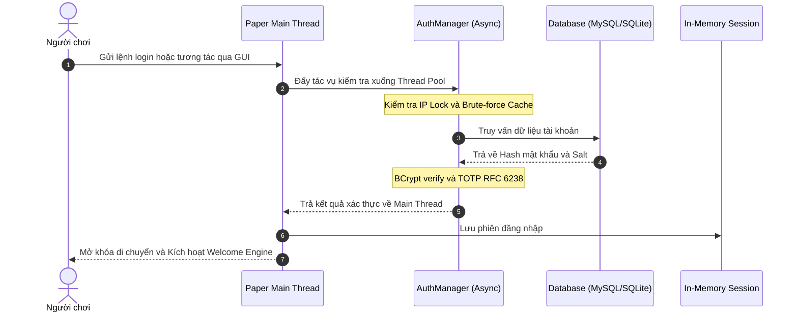

# 🛡️ Blogin - Next-Gen Minecraft Authentication Plugin

<p align="center">
  
  
  
  
  
</p>

<p align="center">
  <a href="#-tổng-quan">Tổng quan</a> •
  <a href="#-bản-vá-320--hỗ-trợ-đa-ngôn-ngữ-i18n">Bản vá 3.2.0</a> •
  <a href="#-cài-đặt">Cài đặt</a> •
  <a href="#-lệnh--quyền">Lệnh & Quyền</a> •
  <a href="#-cấu-hình">Cấu hình</a> •
  <a href="#-troubleshooting">Troubleshooting</a>
</p>

---

## 🌟 Tổng quan

**Blogin** là plugin xác thực danh tính thế hệ mới dành cho Paper/Spigot server. Được thiết kế theo chuẩn doanh nghiệp nhằm tối ưu hóa hiệu năng, xử lý triệt để tình trạng nghẽn Main Thread (Zero TPS Drop) khi có hàng loạt người chơi đăng nhập cùng lúc, tích hợp GUI tương tác trực quan, chống brute-force đa tầng và hệ thống đa ngôn ngữ tự động (i18n).

---

## 🎯 Tính năng nổi bật

### 🔒 Bảo mật tối đa (Hardened Security)
* **BCrypt Hashing:** Tự động điều chỉnh cost factor (4-16) kèm cơ chế tự động re-hash khi nâng độ phức tạp.
* **Mã hóa 2FA (RFC 6238 TOTP):** Tương thích hoàn toàn với Google Authenticator, Authy, Microsoft Authenticator. Toàn bộ secret key lưu trữ trong database được mã hóa bằng thuật toán AES-GCM (256-bit).
* **Chống Brute-Force & Bot:** Tự động khóa IP hoặc Account khi vượt ngưỡng đăng nhập sai. Tích hợp Captcha ngẫu nhiên chống script tự động đăng ký.

### ⚡ Hiệu năng vượt trội (Zero-Lag Engine)
* **100% Async Database & Crypto:** Toàn bộ truy vấn SQL (SQLite / MySQL) và quá trình tính toán hash BCrypt đều chạy trên Thread Pool riêng biệt, giải phóng hoàn toàn Main Thread.
* **Connection Pool Thông Minh:** Tối ưu hóa kết nối, tự động thu hồi và dọn dẹp các connection quá hạn.
* **Adaptive Performance:** Tự động giảm tần suất hiển thị particle khi server đông người (>60 người chơi) để đảm bảo FPS client.

### 🖥️ Giao diện GUI Đăng Nhập Trực Quan
* Panel rương 27 ô trực quan, không lo gõ nhầm lệnh trên màn hình chat.
* Hiển thị đầu skin người chơi (Player Head) với hiệu ứng lấp lánh (glint).
* Nhập mật khẩu / 2FA / Captcha mượt mà qua chat với cơ chế ẩn tin nhắn tự động.

### 🎆 Hệ thống Welcome sống động
* Tích hợp 12 loại particle 3D (Cầu vồng, Galaxy, Cánh thiên thần, Portal...).
* Pháo hoa, hiệu ứng âm thanh hợp âm, BossBar gradient và hiệu ứng Typewriter title.

---

## 🔄 Luồng xác thực bất đồng bộ (Lifecycle Flow)



---

## 🌍 Bản vá 3.2.0 — Hỗ trợ đa ngôn ngữ (i18n)

### 🎯 10 Ngôn ngữ hoàn chỉnh

| Mã | Ngôn ngữ | Mã | Ngôn ngữ |
|:---:|---|:---:|---|
| `vi` | 🇻🇳 Tiếng Việt (Mặc định) | `ja` | 🇯🇵 日本語 |
| `en` | 🇬🇧 English | `ko` | 🇰🇷 한국어 |
| `zh` | 🇨🇳 简体中文 | `ru` | 🇷🇺 Русский |
| `es` | 🇪🇸 Español | `pt` | 🇵🇹 Português |
| `fr` | 🇫🇷 Français | `de` | 🇩🇪 Deutsch |

> Mỗi ngôn ngữ có **217 khóa thông điệp** — bao gồm chat, GUI, title, actionbar, bossbar và thang độ mạnh mật khẩu.

### 🔄 Thứ tự ưu tiên xác định ngôn ngữ

```text
1. Người chơi tự chọn   →  /blogin language <mã>  (lưu theo UUID)
2. Ngôn ngữ Client      →  Tự động nhận diện Player#getLocale()
3. Cấu hình Server      →  config.yml: ngon-ngu: "vi"
4. Fallback File        →  Tự động chuyển về vi.yml nếu thiếu key
5. Hardcoded String     →  Chuỗi mặc định trong mã nguồn
```

---

## 🚀 Bản vá 3.1.0 & 3.0.1 — Sửa lỗi & Nâng cấp hệ thống

* 🔴 **Lỗ hổng Captcha GUI:** Bổ sung bước kiểm tra Captcha bắt buộc trong GUI (ngăn chặn bypass bằng `/blogingui`).
* 🔴 **Plaintext Memory Leak:** Xóa sạch chuỗi mật khẩu trong RAM ngay sau khi hoàn tất xác thực.
* 🟡 **Giảm tải Main Thread DB:** Chuyển bộ đếm số lần thử thất bại sang Concurrent Cache trong RAM thay vì query liên tục vào DB.
* 🟢 **Tương thích Paper 1.20.1 - 1.21.11 - 26.x:**
  * Lớp `Compat` tự động nhận diện hằng số enum (`DUST` / `REDSTONE`, `SLOWNESS` / `SLOW`).
  * Sửa lỗi Adventure API (`ComponentBuilder`, đảo thứ tự tham số `TextColor.lerp`).
  * Fix lỗi particle `count = 0` không hiển thị trên các bản Minecraft mới.

---

## 📦 Cài đặt

### Yêu cầu hệ thống
* **Java:** JDK 17 trở lên (Bản build cho Paper 26.x yêu cầu JDK 25).
* **Nền tảng:** Paper, Purpur hoặc Spigot (1.20.1 đến 1.21.11, Paper 26.x).
* **Database (Tùy chọn):** SQLite (mặc định không cần cài đặt) hoặc MySQL/MariaDB.

### Hướng dẫn cài đặt
1. Tải bản build mới nhất `Blogin-3.2.0.jar` từ mục [Releases](https://github.com/taolaadminshopok1/blogin-plugin/releases).
2. Copy file `.jar` vào thư mục `plugins/` của máy chủ.
3. Khởi động lại server để tạo cấu hình mặc định.
4. Tùy chỉnh thông số trong `plugins/Blogin/config.yml` và chạy lệnh `/blogin reload`.

> ⚠️ **LƯU Ý QUAN TRỌNG:** File `plugins/Blogin/secret.key` là khóa giải mã 2FA. **Tuyệt đối không xóa hoặc chia sẻ file này**. Nếu mất file, tất cả mã 2FA của người chơi sẽ không thể phục hồi.

---

## 🎮 Lệnh & Quyền hạn

### Dành cho người chơi

| Lệnh | Bí danh | Mô tả |
|---|---|---|
| `/login <mật_khẩu> [2fa]` | `/dangnhap` | Đăng nhập vào hệ thống |
| `/register <mật_khẩu> <nhập_lại>` | `/dangky`, `/reg` | Đăng ký tài khoản |
| `/blogingui` | `/bgui`, `/logingui` | Mở bảng đăng nhập đồ họa |
| `/logout` | `/dangxuat` | Đăng xuất khỏi tài khoản |
| `/changepassword <cũ> <mới>` | `/cpass`, `/doimatkhau` | Đổi mật khẩu |
| `/2fa <enable\|confirm\|disable\|status>` | `/totp`, `/otp` | Quản lý xác thực 2 bước Google Authenticator |
| `/captcha` | `/cap` | Làm mới mã Captcha |
| `/blogin language [mã]` | `/lang`, `/ngonngu` | Thay đổi ngôn ngữ hiển thị |

### Dành cho Quản trị viên (Quyền: `blogin.admin`)

| Lệnh | Mô tả |
|---|---|
| `/blogin reload` | Nạp lại cấu hình và ngôn ngữ |
| `/blogin force <player>` | Ép đăng nhập ngay lập tức cho người chơi |
| `/blogin reset <player> <mật_khẩu>` | Đặt lại mật khẩu mới cho người chơi |
| `/blogin unlock <player>` | Mở khóa tài khoản/IP bị chặn do brute-force |
| `/blogin unregister <player>` | Xóa dữ liệu tài khoản |
| `/blogin info <player>` | Xem chi tiết thông tin và trạng thái bảo mật |
| `/blogin 2fa <player> <on\|off\|secret>` | Quản trị từ xa xác thực 2 bước |
| `/blogin list [trang]` | Liệt kê danh sách tài khoản |
| `/blogin status` | Kiểm tra tài nguyên và trạng thái hoạt động |
| `/bloginwelcome` | Quản trị và thử nghiệm các hiệu ứng Welcome |

---

## ⚙️ Cấu hình mẫu (`config.yml`)

```yaml
# Thời gian chờ đăng nhập (giây)
thoi-gian-dang-nhap: 60
ngon-ngu: "vi"
debug: false
log-su-kien: true

# Thiết lập Database
database:
  loai: "SQLITE"        # SQLITE hoặc MYSQL
  async-threads: 2
  mysql:
    host: "localhost"
    port: 3306
    database: "blogin"
    username: "root"
    password: ""
    pool-size: 10
    use-ssl: false

# Thiết lập Bảo mật
bao-mat:
  so-lan-sai-toi-da: 5
  thoi-gian-khoa: 300
  che-do-khoa: "BOTH"   # ACCOUNT | IP | BOTH
  bcrypt-cost: 12       # 4-16 (Khuyến nghị: 10 cho máy chủ nhỏ, 12-13 cho Dedicated)
  chan-mat-khau-yeu: true
  diem-mat-khau-toi-thieu: 2
  chu-ky-don-dep: 300
  mat-khau-toi-thieu: 6
  mat-khau-toi-da: 64

# Giao diện Chest GUI
gui:
  bat: true
  auto-mo: true
  tieu-de: "&#FF8C00&lBLOGIN &#7F8C8D| &#FFFFFF{player}"
  hien-dau-nguoi-choi: true
  hien-o-captcha: true

# Xác thực 2 bước (TOTP)
two-factor:
  bat: true
  ten-issuer: "BloginVN"
  bat-buoc-admin: true
  so-chu-so: 6
  thoi-gian-hieu-luc: 30
  do-lech-cho-phep: 1
```

---

## 🔌 PlaceholderAPI

| Placeholder | Trả về | Mô tả |
|---|---|---|
| `%blogin_authenticated%` | `yes` / `no` | Trạng thái đăng nhập |
| `%blogin_registered%` | `yes` / `no` | Trạng thái đăng ký |
| `%blogin_2fa%` | `yes` / `no` | Trạng thái bật 2FA |
| `%blogin_ip%` | String | Địa chỉ IP đăng ký ban đầu |
| `%blogin_ip_current%` | String | Địa chỉ IP phiên hiện tại |
| `%blogin_logins%` | Số | Tổng số lần đăng nhập |
| `%blogin_lock_remaining%` | Số (giây) | Thời gian còn lại nếu bị khóa |
| `%blogin_remaining_attempts%`| Số | Số lượt thử mật khẩu còn lại |
| `%blogin_timeout%` | Số (giây) | Thời gian đếm ngược đăng nhập còn lại |
| `%blogin_total_players%` | Số | Tổng số tài khoản trên hệ thống |
| `%blogin_version%` | String | Phiên bản plugin hiện tại |

---

## 🛠️ Hướng dẫn build từ Source

```bash
# Clone repository về máy
git clone https://github.com/taolaadminshopok1/blogin-plugin.git
cd blogin-plugin

# 1. Đóng gói bản Universal JAR (Chạy đa phiên bản 1.20.1 -> 1.21.11 -> 26.x)
mvn clean package

# 2. Biên dịch riêng cho Paper 1.21.11
mvn clean package -P paper-1.21.11

# 3. Biên dịch cho Paper 26.x (Yêu cầu JDK 25)
mvn clean package -P paper-26

# Môi trường Windows (PowerShell Wrapper tự dò tìm Maven và JDK)
.\mvnw.ps1 clean package
```

File JAR kết quả nằm tại: `target/Blogin-3.2.0.jar`.

---

## 🐛 Troubleshooting

* **Lỗi kết nối cơ sở dữ liệu:**
  * Đối với MySQL: Kiểm tra lại thông tin Host, Port, Database, User và Password trong `config.yml`. Đảm bảo máy chủ MySQL đã cấp quyền truy cập từ xa nếu không cùng host.
  * Đối với SQLite: Đảm bảo tiến trình server có quyền ghi (Read/Write) vào thư mục `plugins/Blogin/`.
* **Không mở được giao diện GUI:**
  * Kiểm tra xem cấu hình `gui.bat` và `gui.auto-mo` đã đặt thành `true` chưa. Bạn có thể mở thủ công bằng lệnh `/blogingui`.
* **Mã xác thực 2FA báo không chính xác:**
  * Đồng bộ lại thời gian trên hệ thống máy chủ (NTP Sync). TOTP phụ thuộc chặt chẽ vào thời gian thực tế.
  * Tăng nhẹ tham số `do-lech-cho-phep: 2` trong config nếu client có độ trễ mạng lớn.

---

## 📜 License

Dự án được phân phối dưới giấy phép **MIT License**. Xem chi tiết tại tệp [LICENSE](LICENSE).
